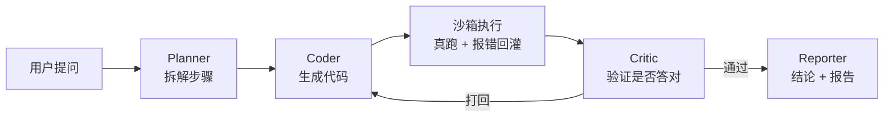

# mdagent — 多智能体数据分析 Agent

[](https://github.com/HeimRig/mdagent/actions/workflows/ci.yml)
[](https://www.python.org/)
[](LICENSE)

用自然语言问一份 CSV / SQLite，自动生成代码、**真实执行**、自我校验、输出结论报告。

这个项目最大的不同不是"能跑"，而是**能报出自己有多准**：自带一套 benchmark，
一条命令复现全部指标。

## 它解决什么问题

拿到一份陌生数据，业务方问"哪个城市卖得最好"，你需要：看懂字段 → 想清楚怎么算 →
写 SQL → 跑 → 发现结果不对 → 改。多智能体就是把这四步显式拆开、互相检查。

## 为什么不是又一个套壳

| 机制 | 做法 | 解决什么 |
|------|------|----------|
| 执行即验证 | 代码在子进程沙箱真跑，报错原文回灌 | "生成完就交"的幻觉 |
| Schema 注入 | 表结构 + 类型 + 样例行先喂给 Planner | 模型编造字段名 |
| 自愈预算 | 最多 N 轮，超了明确报失败 | 死循环 / 硬编答案 |
| 全链路 trace | 每步 prompt、代码、stderr 落盘 | 不可复现、没法 debug |

## 架构



四角色分工见 [docs/architecture.md](docs/architecture.md)。

## 快速开始

需要 **Python 3.10+**（代码里用了 `str | None` 语法）。

国内网络直连 PyPI 经常拿不到包，装依赖时加个镜像：

```bash
# 一次性指定镜像（推荐，清华源）
pip install -r requirements.txt -i https://pypi.tuna.tsinghua.edu.cn/simple

# 或者永久改掉 pip 的默认源
python -m pip config set global.index-url https://pypi.tuna.tsinghua.edu.cn/simple
python -m pip config set global.trusted-host pypi.tuna.tsinghua.edu.cn
```

```bash
# 0) 起网页界面（能直接点着玩，也方便录 GIF）
python app.py

# 1) 跑一道题，默认离线基线，不需要任何 API key
python main.py

# 2) 跑 benchmark，输出报告
python -m mdagent.eval.runner

# 3) 单元测试
pytest -q

# 4) 改了数据就重算答案键（题目和 gold SQL 在 benchmarks/basic.yaml 里）
make key
```

用真模型跑同一套 benchmark：

```bash
# 在 config.py 顶部把 LLM_PROVIDER 改成 deepseek，或：
set MDA_LLM_API_KEY=sk-xxxx        # Windows
python -m mdagent.eval.runner --provider deepseek
```

支持 `deepseek` / `moonshot` / `openai` / `siliconflow` / `ollama`，以及任何
OpenAI 兼容端点（自己填 `MDA_LLM_BASE_URL`）。

### 本地模型（Ollama，不花钱、不联网）

这台机器上用的是 `qwen25-3b`（Qwen2.5-3B-Instruct Q4_K_M）。Ollama 官方仓库在
国内经常下到一半断流，所以走 hf-mirror 拉 GGUF 再导入：

```bash
# 1) 装 Ollama：https://ollama.com/download
# 2) 下 GGUF（hf-mirror 实测 50MB/s 以上）
curl -L -o qwen2.5-3b-q4_k_m.gguf \
  https://hf-mirror.com/Qwen/Qwen2.5-3B-Instruct-GGUF/resolve/main/qwen2.5-3b-instruct-q4_k_m.gguf

# 3) 导入（Modelfile 里配了 Qwen 的 ChatML 模板和 stop token）
ollama create qwen25-3b -f docs/Modelfile.qwen25-3b

# 4) 跑
python main.py
```

网络好的话也可以直接 `ollama pull qwen2.5:7b`，再把 `config.py` 的 `LLM_MODEL` 改掉。

### 沙箱后端（可选）

默认 `auto`：有 Docker 镜像就用 Docker，没有就用子进程。

```bash
make docker-image          # 构建 mdagent-sandbox（只装 duckdb + pandas，约 200MB）
# 之后自动生效；也可以强制指定
set MDA_SANDBOX=docker     # 或 subprocess
```

Docker 后端跑的是 `--network=none --read-only`、数据只读挂载、512MB 内存 / 1 CPU 上限，
生成的代码既连不了网也写不了盘。子进程后端只做超时和密钥环境变量清理，**它不是安全边界**。

国内网络下构建镜像有两处会卡，仓库里都已经绕过：

- **拉基础镜像**：`registry-1.docker.io:443` 直连超时 → 在 Docker Desktop 的
  `~/.docker/daemon.json` 里加 `registry-mirrors`
- **容器内装依赖**：pip 默认走 `pypi.org` → Dockerfile 用 `ARG PIP_INDEX` 指向阿里源，
  需要换源时覆盖即可：

```bash
docker build -t mdagent-sandbox docker/ --build-arg PIP_INDEX=https://pypi.org/simple/
```

## 数据集

`data/sample/sales.csv`：240 笔订单，2026 年 1–6 月，6 个城市、5 个分类、13 个 SKU。
固定随机种子生成，`make data` 可完整复现。

## Benchmark

24 道题，覆盖 8 类题型：top1 / count / aggregate / groupby / filter / timeseries /
ratio / multistep。每题的期望答案**由同题的 reference SQL 在数据集上实算得到**
（`make key` 可重算），题目和 gold SQL 都写在 `mdagent/eval/benchmarks/basic.yaml`，
可以逐条复核——不是手敲的一串数字。

判分优先子串匹配，数字再走一次容差比较（`49120.80` 与 `49120.8` 视为相同）。
报告里会标出本次用的沙箱后端。

**本地 qwen2.5-3B（Ollama + RTX 4060 Laptop 8G）实测**：

| 指标 | 数值 |
|------|------|
| 答案准确率 | 20/24 = **83.33%** |
| 执行成功率 | 95.83% |
| Critic 通过率 | 79.17% |
| 平均自愈轮数 | 1.46 |
| 平均延迟 | 3.87 s/题 |
| 平均 token | 1796 |

| 题型 | 题数 | 准确率 |
|------|------|--------|
| filter | 5 | 100% |
| groupby | 2 | 100% |
| ratio | 2 | 100% |
| count | 1 | 100% |
| top1 | 5 | 80.00% |
| multistep | 4 | 75.00% |
| aggregate | 3 | 66.67% |
| timeseries | 2 | 50.00% |

4 道错题都不是"不会写 SQL"，而是**该聚合的地方没聚合**：

- q7 / q23 把明细当答案（问"最高是多少"，给了 `MAX(amount)` 或整张 Top3 明细，没有 `SUM`）
- q19 要平均值，模型把每笔订单的件数全打了出来
- q5 时间序列写错，自愈 3 轮仍未跑通

**离线规则基线**（无 API key、CI 用、`make bench` 复现）：准确率 7/24 = 29.17%、
执行成功率 100%、平均 1.0 轮。

> 这套题连跑三次，`full` 都是 20/24（q5/q7/q19/q23 稳定失败），但个别题在复跑时
> 会翻转（q10 出现过一次例外）。24 题下单题抖动约 ±4 个百分点，所以下面的消融
> 只比同一轮内的相对差异，不追绝对值。

报告落在 `mdagent/eval/reports/report.md`。

## 消融实验

`RunConfig` 把四个组件做成了开关（Planner / Critic / schema 注入 / 自愈轮数），
逐项关掉再跑同一套 24 题，就能看出每个组件值多少分：

```bash
make ablation                                        # 离线基线
python -m mdagent.eval.ablation --provider ollama    # 本地模型
```

**qwen2.5-3B 实测**：

| 配置 | 说明 | 答案准确率 | 执行成功率 | 平均自愈轮数 |
|------|------|-----------|-----------|-------------|
| `full` | 完整四角色 | **83.33%** | **95.83%** | 1.42 |
| `no_critic` | 去掉 Critic 校验 | 75.00% | 91.67% | 1.00 |
| `no_repair` | 只生成一次代码，不自愈 | 75.00% | 91.67% | 1.00 |
| `no_schema` | 不注入表结构 | **54.17%** | 62.50% | 2.00 |
| `single_agent` | 单 agent（无 Planner、无 Critic、单轮） | 58.33% | 95.83% | 1.00 |

结论：

- **schema 注入是影响最大的单个组件**：不给表结构，模型就开始猜字段名，准确率掉
  29 个百分点、执行成功率掉 33 个百分点，而且轮数反而涨到 2.0——它在盲目重试。
- **Critic + 自愈值 8.33 个百分点**，救回来的是 q10（日期过滤）和 q15（条件占比）：
  这类题模型第一遍会写错条件，能被打回才有第二次机会。注意当前实现里
  `no_critic` 与 `no_repair` 数值完全一致——关掉 Critic 就没人打回，轮数天然锁死在 1。
- **Planner 值 16.67 个百分点**（`no_repair` 75.00% → `single_agent` 58.33%）。
  没有步骤拆解，模型在多表条件（q4 / q11 / q18 / q20 / q22）上明显更容易漏条件。
- 代价是多花 0.4 轮调用（1.42 vs 1.00）。

> **扩题本身改变了结论。** 只有 6 道题时，Planner 看起来"多余"、Critic 看起来
> "不影响正确率"，所有配置几乎同分；扩到 24 题之后，组件之间的差异才稳定显现。
> 这也说明小样本 benchmark 给出的结论可能是反的——评测集的题量和题型覆盖，
> 比指标本身更值得先下功夫。

报告落在 `mdagent/eval/reports/ablation.md`（逐题明细在 `ablation.json`）。

> 附：离线规则基线跑同一套消融，五组数值必然相同（它是"关键词 → SQL"的规则映射，
> 不读 schema、也不做二次判断）。这恰好说明离线后端只能当"跑通"用的对照组。

## 目录结构

```
mdagent/
├── main.py                     入口，点运行即用
├── app.py                      Gradio 网页界面
├── config.py                   所有可调常量都在文件顶部
├── mdagent/
│   ├── agents/                 planner / coder / critic / reporter
│   ├── graph/pipeline.py       LangGraph 状态机（含无依赖退化路径）
│   ├── runtime/sandbox.py      子进程 / Docker 双后端，auto 自动回退
│   ├── llm/                    offline / openai 兼容后端
│   └── eval/                   benchmark + 指标 + 报告 + 消融实验
│       └── benchmarks/         题目 + gold SQL + 答案键生成器
├── data/
│   ├── generate_sample.py      样例数据生成器（固定种子）
│   └── sample/sales.csv        240 笔订单
├── docker/Dockerfile           沙箱镜像（duckdb + pandas）
├── docs/architecture.md        设计取舍说明
└── .github/workflows/ci.yml    push 自动跑测试 + benchmark
```

## 路线图

- [x] 四角色流水线 + 自愈回路
- [x] 子进程沙箱 + 超时
- [x] benchmark + 指标 + CI
- [x] 消融实验脚本（`RunConfig` 开关 + 对比表）
- [x] 真模型实测：本地 qwen2.5-3B 跑 benchmark + 消融，数字已填进本 README
- [x] benchmark 扩到 24 题 + 8 类题型 + gold SQL 答案键 + 分题型统计
- [x] 沙箱换成 Docker（`--network=none --read-only`，`auto` 自动回退）
- [x] Gradio 界面（`python app.py`，四个角色的中间产物都能展开看）
- [ ] 自动出图：让 Reporter 生成 matplotlib 图并嵌进报告
- [ ] 多表 / SQLite 数据源

## License

MIT
