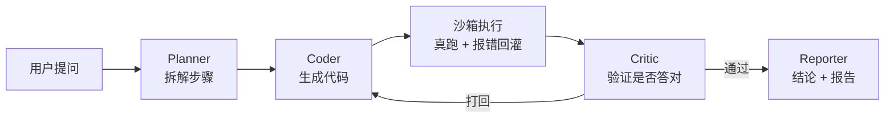

# mdagent — 多智能体数据分析 Agent

[](https://github.com/HeimRig/mdagent/actions/workflows/ci.yml)
[](https://www.python.org/)
[](LICENSE)

用自然语言问一份 CSV / SQLite，自动生成代码、**真实执行**、自我校验、输出结论报告。

这个项目最大的不同不是"能跑"，而是**能报出自己有多准**：自带一套 benchmark，
一条命令复现全部指标。

## 它解决什么问题

拿到一份陌生数据，业务方问"哪个城市卖得最好"，你需要：看懂字段 → 想清楚怎么算 →
写 SQL → 跑 → 发现结果不对 → 改。多智能体就是把这四步显式拆开、互相检查。

## 为什么不是又一个套壳

| 机制 | 做法 | 解决什么 |
|------|------|----------|
| 执行即验证 | 代码在子进程沙箱真跑，报错原文回灌 | "生成完就交"的幻觉 |
| Schema 注入 | 表结构 + 类型 + 样例行先喂给 Planner | 模型编造字段名 |
| 自愈预算 | 最多 N 轮，超了明确报失败 | 死循环 / 硬编答案 |
| 全链路 trace | 每步 prompt、代码、stderr 落盘 | 不可复现、没法 debug |

## 架构



四角色分工见 [docs/architecture.md](docs/architecture.md)。

## 快速开始

需要 **Python 3.10+**（代码里用了 `str | None` 语法）。

国内网络直连 PyPI 经常拿不到包，装依赖时加个镜像：

```bash
# 一次性指定镜像（推荐，清华源）
pip install -r requirements.txt -i https://pypi.tuna.tsinghua.edu.cn/simple

# 或者永久改掉 pip 的默认源
python -m pip config set global.index-url https://pypi.tuna.tsinghua.edu.cn/simple
python -m pip config set global.trusted-host pypi.tuna.tsinghua.edu.cn
```

```bash
# 0) 起网页界面（能直接点着玩，也方便录 GIF）
python app.py

# 1) 跑一道题，默认离线基线，不需要任何 API key
python main.py

# 2) 跑 benchmark，输出报告
python -m mdagent.eval.runner

# 3) 单元测试
pytest -q

# 4) 连跑 3 次看结果稳不稳（输出逐题翻转情况）
python -m mdagent.eval.stability --provider deepseek --runs 3

# 5) 改了数据就重算答案键（题目和 gold SQL 在 benchmarks/basic.yaml 里）
make key
```

用真模型跑同一套 benchmark：

```bash
# 把 key 写进项目根的 .env（已在 .gitignore 里，不会被提交）
echo "MDA_LLM_API_KEY=sk-xxxx" > .env

python -m mdagent.eval.runner --provider deepseek
```

`config.py` 会先读环境变量，再读 `.env`，所以两种方式都行；密钥不落在代码里。
换模型只改 `--provider`，不用动 `LLM_MODEL`——没显式指定时用各 provider 的预设模型。

支持 `deepseek` / `moonshot` / `openai` / `siliconflow` / `ollama`，以及任何
OpenAI 兼容端点（自己填 `MDA_LLM_BASE_URL`）。

### 本地模型（Ollama，不花钱、不联网）

这台机器上用的是 `qwen25-3b`（Qwen2.5-3B-Instruct Q4_K_M）。Ollama 官方仓库在
国内经常下到一半断流，所以走 hf-mirror 拉 GGUF 再导入：

```bash
# 1) 装 Ollama：https://ollama.com/download
# 2) 下 GGUF（hf-mirror 实测 50MB/s 以上）
curl -L -o qwen2.5-3b-q4_k_m.gguf \
  https://hf-mirror.com/Qwen/Qwen2.5-3B-Instruct-GGUF/resolve/main/qwen2.5-3b-instruct-q4_k_m.gguf

# 3) 导入（Modelfile 里配了 Qwen 的 ChatML 模板和 stop token）
ollama create qwen25-3b -f docs/Modelfile.qwen25-3b

# 4) 跑
python main.py
```

网络好的话也可以直接 `ollama pull qwen2.5:7b`，再把 `config.py` 的 `LLM_MODEL` 改掉。

### 沙箱后端（可选）

默认 `auto`：有 Docker 镜像就用 Docker，没有就用子进程。

```bash
make docker-image          # 构建 mdagent-sandbox（只装 duckdb + pandas，约 200MB）
# 之后自动生效；也可以强制指定
set MDA_SANDBOX=docker     # 或 subprocess
```

Docker 后端跑的是 `--network=none --read-only`、数据只读挂载、512MB 内存 / 1 CPU 上限，
生成的代码既连不了网也写不了盘。子进程后端只做超时和密钥环境变量清理，**它不是安全边界**。

国内网络下构建镜像有两处会卡，仓库里都已经绕过：

- **拉基础镜像**：`registry-1.docker.io:443` 直连超时 → 在 Docker Desktop 的
  `~/.docker/daemon.json` 里加 `registry-mirrors`
- **容器内装依赖**：pip 默认走 `pypi.org` → Dockerfile 用 `ARG PIP_INDEX` 指向阿里源，
  需要换源时覆盖即可：

```bash
docker build -t mdagent-sandbox docker/ --build-arg PIP_INDEX=https://pypi.org/simple/
```

## 数据集

`data/sample/` 下是同内容的两种形态，都用固定种子生成、`make data` 可完整复现：

| 文件 | 内容 |
|------|------|
| `sales.csv` | 240 笔订单，2026 年 1–6 月，6 个城市、5 个分类、13 个 SKU |
| `products.csv` | 13 个 SKU 的维度表：供应商、进货成本、保质期 |
| `sales.sqlite` | 上面两张表装进一个 SQLite 文件 |

数据源由 `config.DATA_SOURCE` 决定，三种形态都支持（用 `MDA_DATA_SOURCE` 覆盖）：

```bash
set MDA_DATA_SOURCE=data/sample                    # CSV 目录 → sales + products 两张表（默认）
set MDA_DATA_SOURCE=data/sample/sales.csv          # 单个 CSV → 只有 sales
set MDA_DATA_SOURCE=data/sample/sales.sqlite       # SQLite → sales + products
```

沙箱里会根据数据源自动生成建视图的引导代码：CSV 走 `read_csv_auto`，SQLite 走
duckdb 的 `sqlite` 扩展（镜像构建时已预装，`--network=none` 下也能 `LOAD`）。

## Benchmark

27 道题，覆盖 9 类题型：top1 / count / aggregate / groupby / filter / timeseries /
ratio / multistep / join，其中 3 道 join 必须跨 `sales` 和 `products` 两张表。

每题的期望答案**由同题的 reference SQL 在数据集上实算得到**（`make key` 可重算），
题目和 gold SQL 都写在 `mdagent/eval/benchmarks/basic.yaml`，可以逐条复核——
不是手敲的一串数字。

判分优先子串匹配，数字再走一次容差比较（`49120.80` 与 `49120.8` 视为相同）。
报告里会标出本次用的沙箱后端。

**DeepSeek-Chat 实测，27 题 / 多表数据源**：

| 指标 | 数值 |
|------|------|
| 答案准确率 | 26/27 = **96.30%** |
| 执行成功率 | 100% |
| Critic 通过率 | 96.30% |
| 平均自愈轮数 | 1.07 |
| 平均延迟 | 5.28 s/题 |
| 平均 token | 1628 |

| 题型 | 题数 | 准确率 |
|------|------|--------|
| count | 1 | 100% |
| groupby | 2 | 100% |
| filter | 5 | 100% |
| top1 | 5 | 100% |
| aggregate | 3 | 100% |
| ratio | 2 | 100% |
| multistep | 4 | 100% |
| timeseries | 2 | 100% |
| join | 3 | 66.67% |

唯一错题 q27「杭州生鲜供应的商品，一共卖了多少件？」：

```sql
WHERE s.city = '杭州' AND p.supplier = '杭州生鲜供应'
```

供应商的真名是 `杭州生鲜`，模型把它读成「杭州 + 生鲜供应」，多加了一个 city 过滤。
这是**题面歧义**，不是能力问题——题面保留原样，因为改题目去迁就模型会让数字失去意义。

**复跑稳定性（同一份代码连跑 3 次，27 题）**：

| | run 1 | run 2 | run 3 |
|---|---|---|---|
| 答案准确率 | 96.30% | 96.30% | 96.30% |
| 执行成功率 | 100% | 100% | 100% |
| Critic 通过率 | 96.30% | 96.30% | 96.30% |
| 平均自愈轮数 | 1.07 | 1.15 | 1.15 |
| 平均延迟 | 5.72 s | 5.55 s | 5.66 s |
| 平均 token | 1616 | 1700 | 1704 |

准确率极差 **0.00 个百分点**：26 道题三次全中，q27 三次全错，**没有任何一道题
在复跑中翻转**。同样 `temperature=0`，3B 那边一次能差 12 个百分点，DeepSeek 的
稳定性足以支撑单次结果——只有轮数和 token 有小幅浮动，那是自愈回路的不确定性，
不影响最终答案。

**本地 qwen2.5-3B（Ollama + RTX 4060 Laptop 8G）同一套题**：

| 指标 | 3B | DeepSeek-Chat |
|------|-----|--------------|
| 答案准确率 | 14/27 = 51.85% | **26/27 = 96.30%** |
| 执行成功率 | 92.59% | 100% |
| Critic 通过率 | 66.67% | 96.30% |
| 平均自愈轮数 | 1.74 | 1.07 |
| 平均延迟 | 6.03 s/题 | 5.28 s/题 |

3B 的错法有规律，基本是三类：

- **该聚合的地方没聚合**：问"最高是多少"，给了 `MAX(amount)` 或整张 TopN 明细
- **时间过滤条件写错**：月份区间偏移，自愈 3 轮仍未跑通
- **多表之后选错表**：两张表都有 `product` / `category`，3B 偶尔去 `products` 上做聚合

同一份 3B 代码连跑三次，24 题口径准确率是 66.67% / 70.83% / 54.17%——一道题就是
4 个百分点，`temperature=0` 也压不住。这也是最后改用 DeepSeek 出报告数字的原因：
流水线的价值要在模型"基本能写对 SQL"时才看得出来。

**离线规则基线**（无 API key、CI 用、`make bench` 复现）：准确率 7/27 = **25.93%**、
执行成功率 100%、平均 1.0 轮。它连"表名"都靠关键词硬映射，join 组全军覆没，
正好说明这类基线只能当"跑通"的对照组。

报告落在 `mdagent/eval/reports/report.md`。

## 消融实验

`RunConfig` 把四个组件做成了开关（Planner / Critic / schema 注入 / 自愈轮数），
逐项关掉再跑同一套题，就能看出每个组件值多少分：

```bash
make ablation                                        # 离线基线
python -m mdagent.eval.ablation --provider deepseek  # 在线模型
python -m mdagent.eval.ablation --provider ollama    # 本地模型
```

**DeepSeek-Chat 实测（27 题 / 多表）**：

| 配置 | 说明 | 答案准确率 | 执行成功率 | 平均自愈轮数 |
|------|------|-----------|-----------|-------------|
| `full` | 完整四角色 | **96.30%** | **100%** | 1.07 |
| `no_critic` | 去掉 Critic 校验 | 92.59% | 100% | 1.00 |
| `no_repair` | 只生成一次代码，不自愈 | 96.30% | 100% | 1.00 |
| `no_schema` | 不注入表结构 | **77.78%** | **81.48%** | 1.52 |
| `single_agent` | 单 agent（无 Planner、无 Critic、单轮） | 96.30% | 100% | 1.00 |

同一套题换成 3B（24 题单表时期）：

| 配置 | 3B 准确率 | DeepSeek 准确率 |
|------|----------|----------------|
| `full` | 83.33% | 96.30% |
| `no_critic` | 75.00% | 92.59% |
| `no_repair` | 75.00% | 96.30% |
| `no_schema` | 54.17% | 77.78% |
| `single_agent` | 58.33% | 96.30% |

结论：

- **schema 注入是唯一在两种模型上都值钱的组件**：3B 掉 29 个百分点、DeepSeek 掉
  18.5 个百分点，执行成功率也跟着掉——不给表结构，模型就开始猜字段名。
- **其余三个组件的价值随模型变强而塌陷**。3B 下 Planner 值 16.67 个百分点、Critic +
  自愈值 8.33 个百分点；换 DeepSeek 后 `no_repair` 和 `single_agent` 都还是 96.30%，
  分毫不差。原因很直接：3B 是"写不对才需要被打回"，DeepSeek 第一遍就写对了，
  自愈回路和步骤拆解没有发挥空间。
- 也就是说，**脚手架的边际收益是模型能力的函数，不是常数**。组件该不该保留，取决于
  目标模型的下限，不能拿一个模型上的消融结论去套另一个。
- 当前实现里 `no_critic` 与 `no_repair` 的轮数都是 1.0：关掉 Critic 就没人打回，
  轮数天然锁死。

> **小样本会让结论反过来。** 只有 6 道题时，Planner 看起来"多余"、Critic 看起来
> "不影响正确率"，所有配置几乎同分；扩到 24 题之后差异才稳定显现。评测集的题量和
> 题型覆盖，比指标本身更值得先下功夫。

报告落在 `mdagent/eval/reports/ablation.md`（逐题明细在 `ablation.json`）。

> 附：离线规则基线跑同一套消融，五组数值必然相同（它是"关键词 → SQL"的规则映射，
> 不读 schema、也不做二次判断）。这恰好说明离线后端只能当"跑通"用的对照组。

## 目录结构

```
mdagent/
├── main.py                     入口，点运行即用
├── app.py                      Gradio 网页界面
├── config.py                   所有可调常量都在文件顶部
├── mdagent/
│   ├── agents/                 planner / coder / critic / reporter
│   ├── graph/pipeline.py       LangGraph 状态机（含无依赖退化路径）
│   ├── runtime/sandbox.py      子进程 / Docker 双后端，auto 自动回退
│   ├── runtime/data.py         数据源抽象：CSV / CSV 目录 / duckdb / SQLite
│   ├── charts.py               结果表格 → 图表，数据形状不合适就不画
│   ├── llm/                    offline / openai 兼容后端
│   └── eval/                   benchmark + 指标 + 报告 + 消融 / 稳定性复跑
│       └── benchmarks/         题目 + gold SQL + 答案键生成器
├── data/
│   ├── generate_sample.py      样例数据生成器（固定种子）
│   └── sample/
│       ├── sales.csv           240 笔订单
│       ├── products.csv        13 个 SKU 的维度表
│       └── sales.sqlite        上面两张表的 SQLite 版本
├── docker/Dockerfile           沙箱镜像（duckdb + pandas + sqlite 扩展）
├── docs/architecture.md        设计取舍说明
└── .github/workflows/ci.yml    push 自动跑测试 + benchmark
```

## 路线图

- [x] 四角色流水线 + 自愈回路
- [x] 子进程沙箱 + 超时
- [x] benchmark + 指标 + CI
- [x] 消融实验脚本（`RunConfig` 开关 + 对比表）
- [x] 真模型实测：本地 qwen2.5-3B 跑 benchmark + 消融，数字已填进本 README
- [x] benchmark 扩到 27 题 + 9 类题型（含跨表 JOIN）+ gold SQL 答案键 + 分题型统计
- [x] 沙箱换成 Docker（`--network=none --read-only`，`auto` 自动回退）
- [x] Gradio 界面（`python app.py`，四个角色的中间产物都能展开看）
- [x] 自动出图：结果表格满足「类别列 + 数值列」时画柱状图（`mdagent/charts.py`）
- [x] 多表 / SQLite 数据源（`mdagent/runtime/data.py`，`MDA_DATA_SOURCE` 三选一）

## License

MIT
